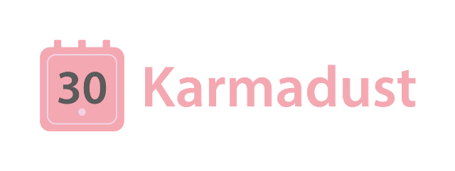
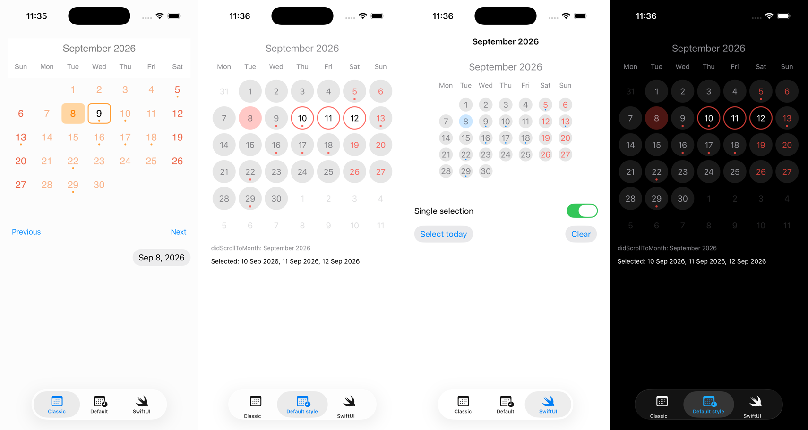

<p align="center">
  
</p>

# KDCalendar

A month calendar for iOS. Drop it in, give it a start and an end date, and it scrolls one month per page, horizontally or vertically, with today marked, weekends coloured, days selected by tap and events shown as dots.

- **UIKit and SwiftUI.** `CalendarView` for UIKit, `KDCalendarView` for SwiftUI with two-way bindings for the selection and the month on screen.
- **Any calendar.** The user's current calendar and time zone by default; Gregorian, Persian, Hebrew or anything else through `Style.calendar`, with the week starting on the day the locale says.
- **System events.** The optional `KDCalendarEventKit` product loads events from the user's calendars and adds new ones.
- **Single, multiple or range selection.** Two taps select every day between them, across months.
- **Styled by value.** `CalendarView.Style` is a struct; change a property and the view follows. Dynamic system colours and Dynamic Type by default, and a per-day style hook for holidays and disabled days.
- **Swift 6, iOS 17+.** Main-actor isolated, `Sendable` where it matters, VoiceOver labels on every day in the language of the style's locale.

<p align="center">
  
</p>

## Installation

### Swift Package Manager

In Xcode choose File, then Add Package Dependencies, and enter:

```
https://github.com/mmick66/CalendarView
```

Or in `Package.swift`:

```swift
.package(url: "https://github.com/mmick66/CalendarView", from: "2.1.0")
```

Add the `KDCalendar` product to your target, and `KDCalendarEventKit` as well if you want system calendar events.

### CocoaPods

2.0.1 is the final CocoaPods release; later fixes ship through Swift Package Manager only. Prefer Swift Package Manager.

```ruby
pod 'KDCalendar', '~> 2.0'            # the calendar
pod 'KDCalendar/EventKit', '~> 2.0'   # plus system events
```

## Usage

### Setup

`CalendarView` is a `UIView`. Create it in code or in a storyboard (set the module to `KDCalendar`), then give it a data source and a delegate:

```swift
import KDCalendar

let calendarView = CalendarView(frame: .zero)
calendarView.dataSource = self
calendarView.delegate = self
calendarView.direction = .horizontal
calendarView.selectionMode = .single
```

The data source returns the first and last selectable day. Every month those days touch is shown; days before the start or after the end are greyed out. Without a data source the view shows the current month.

```swift
extension ViewController: CalendarViewDataSource {
    func startDate() -> Date { Calendar.current.date(byAdding: .month, value: -1, to: Date())! }
    func endDate() -> Date { Calendar.current.date(byAdding: .month, value: 12, to: Date())! }
}
```

The delegate hears about scrolling and selection. Only the first two methods are required.

```swift
extension ViewController: CalendarViewDelegate {
    func calendar(_ calendar: CalendarView, didScrollToMonth date: Date) { }
    func calendar(_ calendar: CalendarView, didSelectDate date: Date, withEvents events: [CalendarEvent]) { }
    func calendar(_ calendar: CalendarView, canSelectDate date: Date) -> Bool { true }
    func calendar(_ calendar: CalendarView, didDeselectDate date: Date) { }
    func calendar(_ calendar: CalendarView, didLongPressDate date: Date, withEvents events: [CalendarEvent]?) { }
}
```

The view holds both weakly, so keep them alive yourself. A view controller that owns the calendar is the usual arrangement.

### Dates

Every date the view computes or hands out is the start of a day in `calendarView.calendar`, which is `style.calendar` (given `style.locale` when it has no locale of its own) and defaults to `Calendar.autoupdatingCurrent`, so it follows the device when its time zone changes. `didScrollToMonth` receives the first day of the month. To work in another time zone or calendar, set one on the style:

```swift
var style = CalendarView.Style()
style.calendar = Calendar(identifier: .persian)
style.firstWeekday = .automatic       // the calendar's, or style.locale's if it has no locale
calendarView.style = style
```

### Scrolling

```swift
calendarView.setDisplayDate(Date())                 // jump to a month
calendarView.setDisplayDate(date, animated: true)   // scroll to it
calendarView.goToNextMonth()
calendarView.goToPreviousMonth()
calendarView.isScrollEnabled = false                // buttons only
calendarView.displayDate                            // the first day of the month on screen
```

Call `setDisplayDate` from `viewDidAppear` or later; before that the view has no size to scroll.

The displayed month is kept across reloads. After `reloadData()`, a new style or a new data source, the calendar stays on the month it displayed wherever the new range puts it, and moves to the nearest month, with a `didScrollToMonth`, when the range no longer has that month.

The grid runs left to right unless you set `forceLtr = false`; it then follows the view's layout direction, from the app's language or from `semanticContentAttribute`, in whichever order the two are set.

### Selection

```swift
calendarView.selectionMode = .multiple   // .single, .multiple or .range
calendarView.selectDate(date)            // same rules as a tap: in range, canSelectDate allows it
calendarView.deselectDate(date)
calendarView.selectRange(monday...friday)
calendarView.selectedDates               // in selection order
calendarView.clearAllSelectedDates()     // no delegate callbacks
calendarView.enableDeselection = false   // taps cannot deselect; deselectDate still can
```

In `.single` mode selecting a day deselects the previous one and reports it. In `.range` mode the first tap picks one end, the second picks the other and every selectable day between them is selected, in either order and across months; the delegate then receives `didSelectRange`. A third tap starts a new range and tapping a selected day clears it. `multipleSelectionEnable` still works: `false` is `.single`, and `true` turns `.single` into `.multiple` and leaves `.range` alone.

The selection is kept as days. When `reloadData()` or a new style rebuilds the grid, the same days stay selected wherever they land; days that are no longer in range are deselected and reported with `didDeselectDate`.

`canSelectDate` is asked for a tap and for `selectDate`, and also for each day as it is drawn, so that VoiceOver announces the days it refuses as dimmed, and again for the days on screen after the selection changes. Keep it quick and free of side effects, and call `reloadData()` when its answers change for another reason than the selection.

### Styling

`CalendarView.Style` is a value. Change what you need and assign it, or mutate the view's style in place.

```swift
var style = CalendarView.Style()
style.cellShape = .round               // .round, .square or .bevel(radius)
style.cellColorToday = .systemOrange.withAlphaComponent(0.3)
style.cellSelectedBorderColor = .systemOrange
style.cellEventColor = .systemOrange
style.firstWeekday = .sunday           // .sunday, .monday, .saturday or .automatic
style.weekdayCasing = .uppercase       // the weekday labels: .capitalized or .uppercase
style.showAdjacentDays = true          // the neighbouring months' days in the empty cells
style.locale = Locale(identifier: "en_US")
calendarView.style = style

calendarView.style.headerFont = .preferredFont(forTextStyle: .title2)   // also restyles
calendarView.marksWeekends = true
```

The defaults are dynamic system colours, so a calendar follows dark mode, and fonts scaled for Dynamic Type. Custom colours and fonts are used as given. `headerHeight` and `weekdaysHeight` are minimums: the header grows when its fonts need more room, as they do at the larger text sizes, the weekday labels fall back to one-letter names, and day numbers shrink to fit their cells.

Styles compare by value, and assigning an equal style does not reload. A colour made with `UIColor { traits in ... }` only equals itself, so create such colours once, in a `static let` for instance, rather than each time the style is built; this matters most for a style built in a SwiftUI `body`.

The data source can replace the month title:

```swift
func title(forMonth month: Date) -> String? { month.formatted(.dateTime.month(.wide)) }
```

The delegate can style single days. Return `nil` for the calendar's own style. Together with `canSelectDate` this greys out days the user must not pick:

```swift
func calendar(_ calendar: CalendarView, canSelectDate date: Date) -> Bool {
    !Calendar.current.isDateInWeekend(date)
}

func calendar(_ calendar: CalendarView, styleForDate date: Date) -> CalendarView.Style? {
    guard Calendar.current.isDateInWeekend(date) else { return nil }
    var disabled = calendar.style
    disabled.cellTextColorWeekend = disabled.cellColorOutOfRange
    disabled.cellColorDefault = .clear
    return disabled
}
```

### Events

`events` is an array of `CalendarEvent`; a day gets a dot for every event that covers it, and `didSelectDate` receives that day's events.

```swift
calendarView.events = [
    CalendarEvent(title: "Launch", startDate: launch, endDate: launch.addingTimeInterval(3600))
]
```

To show the user's system calendars, add the `KDCalendarEventKit` product and declare `NSCalendarsFullAccessUsageDescription` in your Info.plist. The first call asks for access.

```swift
import KDCalendarEventKit

try await calendarView.loadEvents()                     // or the completion form
calendarView.addEvent("Dinner", date: date, duration: 2) // hours; false if access is missing
try calendarView.saveEvent(event)                        // throws the reason instead
```

Set `calendarView.reloadsEventsWhenStoreChanges = true` to keep the dots current while the user edits their calendar in another app: once it has loaded events, the view loads them again when the store reports a change, without asking for access again.

These go through `calendarView.eventsManager`, which is `EventsManager.shared`, around the system event store, by default. To test without calendar access, give the view a manager around your own `CalendarEventStore`: `calendarView.eventsManager = EventsManager(store: fakeStore)`.

### SwiftUI

```swift
import KDCalendar

struct ContentView: View {
    @State private var selection: [Date] = []
    @State private var month = Date()

    var body: some View {
        NavigationStack {
            KDCalendarView(range: start...end, selection: $selection)
                .calendarStyle(style)
                .selectionMode(.range)
                .styleForDate { date in holidays.contains(date) ? holidayStyle : nil }
                .events(events)
                .displayedMonth($month)
                .mirrorsInRightToLeftLayouts()
                .aspectRatio(1, contentMode: .fit)
                .navigationTitle(month.formatted(.dateTime.month(.wide).year()))
                .toolbar { Button("Today") { withAnimation { month = Date() } } }
        }
    }
}
```

Taps update the selection binding; assigning to it selects or deselects days. An assigned value takes the shape of the selection mode: `.single` keeps the last day and `.range` selects every day from the earliest to the latest. When the calendar cannot show the value as given, the binding is set to the days it shows.

`displayedMonth(_:)` binds the month on screen the same way. The calendar sets the binding to the first day of each month it settles on, and assigning any date scrolls to its month, animated inside `withAnimation`; a month outside the range is set back to the month on screen. Because the binding follows the user's swipes, "Today" above works every time. The one-way `displayDate(_:)` scrolls when its value moves to another month, so it cannot return to a month the user swiped away from while the value stayed the same; `onScrollToMonth(_:)` reports each month without a binding.

`mirrorsInRightToLeftLayouts()` lets the grid follow the layout direction of the SwiftUI environment. Without it the grid always runs left to right.

## Example app

`Example/KDCalendarDemo.xcodeproj` has three tabs: the classic styled calendar with system events, the default style in a vertical calendar with disabled Sundays and a holiday, and the SwiftUI wrapper with the three selection modes. Launch with `-sampleEvents` to seed events without calendar access and `-tab 1` or `-tab 2` to open a tab.

## Development

```
xcodebuild -scheme KDCalendar-Package -destination 'platform=iOS Simulator,name=iPhone 17 Pro' test
xcodebuild -project Example/KDCalendarDemo.xcodeproj -scheme KDCalendarDemo -destination 'platform=iOS Simulator,name=iPhone 17 Pro' build
xcrun swift-format lint --strict --recursive Sources Tests Example/KDCalendarDemo
scripts/lint-open-documentation.sh   # swift-format skips `open` declarations
```

Requires Xcode 26. Documentation is a DocC catalog in `Sources/KDCalendar/KDCalendar.docc`, including a guide for migrating from 1.x.

## License

MIT. See [LICENSE](LICENSE).
